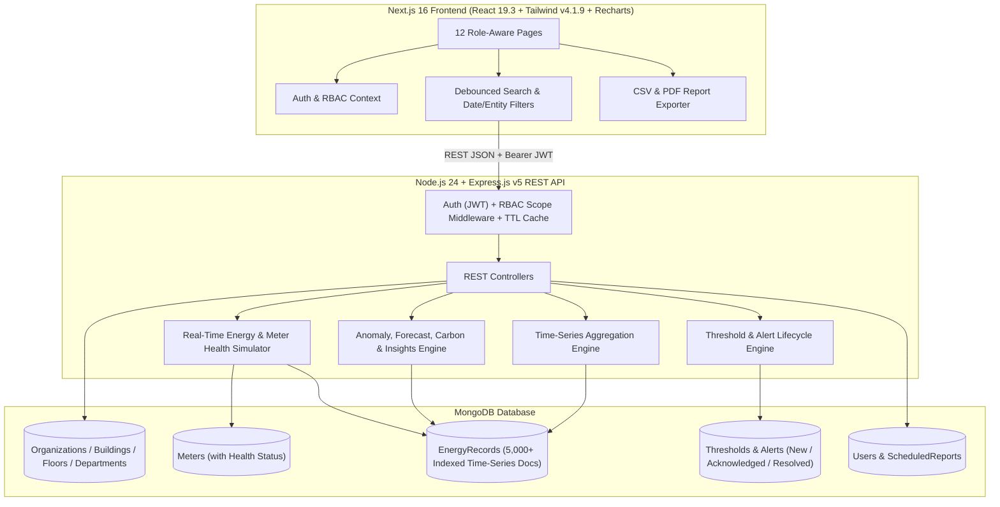

# WATTWISE — Master Architecture & Technical Specification

> **Single Source of Truth for All AI Models**  
> Every AI model (**Gemini 4 Argon**, **Orchestrator (Argon)**, **Gemini 4 Hydrogen**, **Claude Opus 5.5**, **Claude Sonnet 5.5**, **Gemini 3.8 Flash**) MUST follow the schemas, API contracts, folder structure, RBAC rules, and algorithmic specifications defined in this document without deviation.

---

## 1. Tech Stack & Runtime Versions

| Layer | Technology | Version | Purpose |
| :--- | :--- | :--- | :--- |
| **Frontend Framework** | Next.js (App Router) | `16.x` | SSR/CSR hybrid pages, route groups, layouts |
| **UI Library** | React | `19.3.x` | Component architecture, hooks, transitions |
| **Language** | TypeScript | `5.9.x` | End-to-end strict static typing (`strict: true`) |
| **Styling** | Tailwind CSS | `4.1.9` | Utility-first styling, CSS variables, Dark Mode (`dark:`) |
| **Charts & Visualization** | Recharts | `2.15+` / `3.x` | Time-series area/line/bar/composed/pie charts |
| **Icons** | Lucide React | Latest | Consistent industrial/energy iconography |
| **PDF Generation** | `jspdf` + `jspdf-autotable` | Latest | Client/Server PDF energy report generation |
| **Backend Runtime** | Node.js | `24.x` | High-performance JavaScript runtime |
| **Backend Framework** | Express.js | `5.x` | REST API server with native async error handling |
| **Database** | MongoDB + Mongoose | `8.x` | Document + Time-series optimized storage & aggregation |
| **Authentication** | JWT (`jsonwebtoken` + `bcryptjs`) | Latest | Stateless bearer/cookie token auth + role & scope claims |
| **Validation** | `zod` | Latest | Strict request body, query param, and env validation |

---

## 2. Monorepo Directory Structure

```text
WattWise/
├── WattWise.md                      # Original Project Requirements Specification
├── ARCHITECTURE.md                  # Master Architecture & Technical Spec (This File)
├── IMPLEMENTATION_PLAN.md           # Phased Task Breakdown with Model Assignments
├── AI_MODEL_WORKFLOW.md             # Handoff Protocol & Prompt Templates for AI Models
├── PROJECT_STATUS.md                # Living Progress & Contract Tracker
│
├── server/                          # Node.js 24 + Express.js v5 Backend (Port 5000)
│   ├── package.json
│   ├── tsconfig.json
│   ├── .env.example
│   └── src/
│       ├── index.ts                 # Server entry point & graceful shutdown
│       ├── app.ts                   # Express v5 app setup, CORS, middleware, routes
│       ├── config/
│       │   ├── env.ts               # Zod-validated environment configuration
│       │   └── db.ts                # MongoDB connection & index initialization
│       ├── types/
│       │   └── index.ts             # Shared backend interfaces & Express Request augmentation
│       ├── models/
│       │   ├── Organization.ts
│       │   ├── User.ts
│       │   ├── Building.ts
│       │   ├── Floor.ts
│       │   ├── Department.ts
│       │   ├── Meter.ts
│       │   ├── EnergyRecord.ts
│       │   ├── Threshold.ts
│       │   ├── Alert.ts
│       │   └── ScheduledReport.ts
│       ├── middleware/
│       │   ├── auth.middleware.ts   # JWT verification & req.user attachment
│       │   ├── rbac.middleware.ts   # Role check + multi-tenant & entity scope guards
│       │   ├── cache.middleware.ts  # In-memory TTL cache for dashboard & analytics endpoints
│       │   ├── validate.middleware.ts # Zod schema validation middleware
│       │   └── error.middleware.ts  # Centralized Express v5 error handler
│       ├── services/
│       │   ├── costCarbon.service.ts      # Consistent cost ($) & carbon (kg CO2e) engine
│       │   ├── aggregation.service.ts     # Server-side MongoDB time-series aggregations
│       │   ├── alertEngine.service.ts     # Threshold evaluation & auto-alert creation
│       │   ├── anomaly.service.ts         # Statistical Z-score & IQR unusual usage detection
│       │   ├── forecast.service.ts        # Weighted seasonal moving-average forecasting
│       │   ├── insights.service.ts        # Automated energy-saving recommendations engine
│       │   ├── simulator.service.ts       # Real-time energy reading simulator & meter health
│       │   └── reportGenerator.service.ts # CSV export & scheduled report runner
│       ├── controllers/
│       │   ├── auth.controller.ts
│       │   ├── organization.controller.ts
│       │   ├── building.controller.ts
│       │   ├── floor.controller.ts
│       │   ├── department.controller.ts
│       │   ├── meter.controller.ts
│       │   ├── energyRecord.controller.ts
│       │   ├── dashboard.controller.ts
│       │   ├── analytics.controller.ts
│       │   ├── alert.controller.ts
│       │   ├── report.controller.ts
│       │   └── user.controller.ts
│       ├── routes/
│       │   ├── index.ts
│       │   ├── auth.routes.ts
│       │   ├── organization.routes.ts
│       │   ├── building.routes.ts
│       │   ├── floor.routes.ts
│       │   ├── department.routes.ts
│       │   ├── meter.routes.ts
│       │   ├── energyRecord.routes.ts
│       │   ├── dashboard.routes.ts
│       │   ├── analytics.routes.ts
│       │   ├── alert.routes.ts
│       │   ├── report.routes.ts
│       │   └── user.routes.ts
│       └── seed/
│           └── seed.ts              # Deterministic dataset generator (3+ Orgs, 10+ Bldgs, 30+ Floors, 50+ Depts, 5,000+ Records)
│
└── client/                          # Next.js 16 (App Router) + React 19.3 + Tailwind v4.1.9 (Port 3000)
    ├── package.json
    ├── tsconfig.json
    ├── next.config.ts
    ├── postcss.config.mjs
    ├── .env.example
    └── src/
        ├── types/
        │   └── index.ts             # Strictly synced TypeScript interfaces matching backend API contracts
        ├── lib/
        │   ├── api.ts               # Fetch wrapper with JWT injection, error normalization, and query builder
        │   ├── auth-context.tsx     # Auth state provider, role helpers, organization switcher (if demo), route guard
        │   ├── theme-context.tsx    # Dark/Light mode provider persisted in localStorage + document.documentElement
        │   ├── export-utils.ts      # Client-side CSV & PDF report formatting utilities
        │   └── formatters.ts        # kWh, currency ($), kg CO2e, percentage, and date formatters
        ├── hooks/
        │   ├── useDebounce.ts       # Debounced search hook (300ms default)
        │   ├── useFilterState.ts    # Shared date-range, building, floor, department, meter filter hook
        │   └── useRealtimeSim.ts    # Hook to control/poll real-time energy simulation
        ├── components/
        │   ├── layout/
        │   │   ├── AppSidebar.tsx   # Role-aware navigation sidebar for all 12 pages
        │   │   ├── AppHeader.tsx    # Org badge, role pill, live simulator toggle, alert bell, dark mode toggle
        │   │   └── RoleGuard.tsx    # Declarative role-based UI access wrapper
        │   ├── ui/                  # Reusable primitives (Button, Card, Modal, Table, Pagination, Badge, Skeleton, AlertBanner, DateRangePicker, SearchInput)
        │   ├── charts/              # Recharts components
        │   │   ├── HourlyUsageChart.tsx
        │   │   ├── DailyUsageChart.tsx
        │   │   ├── MonthlyUsageChart.tsx
        │   │   ├── BuildingComparisonChart.tsx
        │   │   ├── DepartmentComparisonChart.tsx
        │   │   ├── CostCarbonTrendChart.tsx
        │   │   └── ForecastAnomalyChart.tsx
        │   └── insights/
        │       ├── InsightsPanel.tsx
        │       ├── RecommendationsList.tsx
        │       └── MeterHealthGrid.tsx
        └── app/
            ├── layout.tsx           # Root layout with ThemeProvider & AuthProvider
            ├── page.tsx             # Landing / redirect to /dashboard or /login
            ├── (auth)/
            │   ├── login/page.tsx   # Page 1a: Login (with quick demo-role switcher buttons)
            │   └── register/page.tsx# Page 1b: Organization & User Registration
            └── (dashboard)/
                ├── layout.tsx       # Protected shell with Sidebar + Header
                ├── dashboard/page.tsx    # Page 2: Organization Dashboard
                ├── buildings/page.tsx    # Page 3: Building Management
                ├── floors/page.tsx       # Page 4: Floor Management
                ├── departments/page.tsx  # Page 5: Department Management
                ├── meters/page.tsx       # Page 6: Meter Management & Health Monitoring
                ├── records/page.tsx      # Page 7: Energy Records (Time-series table, filter, create, CSV export)
                ├── analytics/page.tsx    # Page 8: Energy Analytics, Insights, Forecasting & Carbon
                ├── alerts/page.tsx       # Page 9: Alert Management & Threshold Configuration
                ├── reports/page.tsx      # Page 10: Custom Date Reports, Scheduled Reports, CSV & PDF Export
                ├── users/page.tsx        # Page 11: User Management & Scope Assignment
                └── profile/page.tsx      # Page 12: Profile Settings & Organization Preferences
```

---

## 3. System Architecture & Data Flow Diagram



---

## 4. Database Schemas & Indexing Specification (MongoDB / Mongoose)

### 4.1 `Organization`
```typescript
export interface IOrganization {
  _id: Types.ObjectId;
  name: string;                    // e.g., "Apex Global Manufacturing"
  code: string;                    // Unique slug/code, e.g., "APEX-MFG"
  industry: 'Commercial' | 'Manufacturing' | 'University' | 'Healthcare' | 'Technology';
  address: string;
  contactEmail: string;
  contactPhone: string;
  currency: string;                // Default: "USD"
  baseTariffPerKwh: number;        // Default: 0.14 ($/kWh)
  peakTariffPerKwh: number;        // Default: 0.22 ($/kWh during peak hours 14:00-20:00)
  carbonFactorKgPerKwh: number;    // Default: 0.42 (kg CO2e per kWh)
  timezone: string;                // Default: "UTC"
  isActive: boolean;
  createdAt: Date;
  updatedAt: Date;
}
// Indexes: { code: 1 } (unique)
```

### 4.2 `User`
```typescript
export type UserRole = 'org_admin' | 'facility_manager' | 'department_manager' | 'viewer';

export interface IUser {
  _id: Types.ObjectId;
  organizationId: Types.ObjectId;  // Ref: Organization (Mandatory multi-tenant boundary)
  name: string;
  email: string;                   // Unique globally
  passwordHash: string;
  role: UserRole;
  // Scoped permissions for Facility Managers, Department Managers, and Viewers:
  assignedBuildingIds: Types.ObjectId[];   // Empty array for org_admin (means all in org)
  assignedDepartmentIds: Types.ObjectId[]; // Mandatory scope for department_manager
  assignedMeterIds: Types.ObjectId[];      // Optional fine-grained scope for facility_manager
  jobTitle?: string;
  phone?: string;
  preferences: {
    theme: 'light' | 'dark' | 'system';
    emailNotifications: boolean;
  };
  isActive: boolean;
  lastLoginAt?: Date;
  createdAt: Date;
  updatedAt: Date;
}
// Indexes: { email: 1 } (unique), { organizationId: 1, role: 1 }
```

### 4.3 `Building`
```typescript
export interface IBuilding {
  _id: Types.ObjectId;
  organizationId: Types.ObjectId;  // Ref: Organization
  name: string;                    // e.g., "North Innovation Tower"
  code: string;                    // e.g., "BLD-NIT-01"
  address: string;
  buildingType: 'Office' | 'Factory' | 'Academic' | 'DataCenter' | 'Warehouse';
  totalFloors: number;
  areaSqFt: number;
  baselineDailyKwh: number;        // Expected normal daily consumption
  isActive: boolean;
  createdAt: Date;
  updatedAt: Date;
}
// Indexes: { organizationId: 1, code: 1 } (unique)
```

### 4.4 `Floor`
```typescript
export interface IFloor {
  _id: Types.ObjectId;
  organizationId: Types.ObjectId;  // Ref: Organization
  buildingId: Types.ObjectId;      // Ref: Building
  floorNumber: number;             // e.g., 1, 2, 3
  name: string;                    // e.g., "Level 2 - Precision Assembly"
  areaSqFt: number;
  createdAt: Date;
  updatedAt: Date;
}
// Indexes: { buildingId: 1, floorNumber: 1 } (unique), { organizationId: 1 }
```

### 4.5 `Department`
```typescript
export interface IDepartment {
  _id: Types.ObjectId;
  organizationId: Types.ObjectId;  // Ref: Organization
  buildingId: Types.ObjectId;      // Ref: Building
  floorId: Types.ObjectId;         // Ref: Floor
  name: string;                    // e.g., "Robotics & Automation Lab"
  code: string;                    // e.g., "DEPT-ROB-02"
  managerName?: string;
  monthlyBudgetUsd: number;
  headcount: number;
  operatingHours: {
    startHour: number;             // e.g., 8 (08:00)
    endHour: number;               // e.g., 18 (18:00)
  };
  createdAt: Date;
  updatedAt: Date;
}
// Indexes: { organizationId: 1, code: 1 } (unique), { buildingId: 1, floorId: 1 }
```

### 4.6 `Meter`
```typescript
export type MeterStatus = 'active' | 'warning' | 'offline' | 'maintenance';

export interface IMeter {
  _id: Types.ObjectId;
  organizationId: Types.ObjectId;  // Ref: Organization
  buildingId: Types.ObjectId;      // Ref: Building
  floorId: Types.ObjectId;         // Ref: Floor
  departmentId: Types.ObjectId;    // Ref: Department
  meterCode: string;               // Unique serial/code, e.g., "MTR-APEX-001"
  name: string;                    // e.g., "HVAC Main Feeder A1"
  meterType: 'Main' | 'Submeter' | 'HVAC' | 'Lighting' | 'Machinery' | 'ServerRack';
  unit: 'kWh';
  status: MeterStatus;
  healthScore: number;             // 0 to 100 (Bonus: Meter Health Monitoring)
  lastReadingAt?: Date;
  firmwareVersion: string;
  installationDate: Date;
  maxCapacityKw: number;
  createdAt: Date;
  updatedAt: Date;
}
// Indexes: { organizationId: 1, meterCode: 1 } (unique), { buildingId: 1 }, { departmentId: 1 }
```

### 4.7 `EnergyRecord` (Time-Series Core Collection)
```typescript
export interface IEnergyRecord {
  _id: Types.ObjectId;
  organizationId: Types.ObjectId;  // Ref: Organization
  buildingId: Types.ObjectId;      // Ref: Building
  floorId: Types.ObjectId;         // Ref: Floor
  departmentId: Types.ObjectId;    // Ref: Department
  meterId: Types.ObjectId;         // Ref: Meter
  timestamp: Date;                 // Normalized to top-of-hour or exact reading timestamp
  consumptionKwh: number;          // Must be >= 0
  estimatedCost: number;           // Consistent tariff calculation ($)
  carbonKg: number;                // Consistent carbon emission calculation (kg CO2e)
  peakDemandKw: number;            // Peak power draw during interval
  powerFactor: number;             // 0.70 - 1.00
  isAnomaly: boolean;              // Flagged by anomaly detector
  anomalyScore: number;            // Z-score magnitude
  source: 'seed' | 'manual' | 'iot_simulator';
  createdAt: Date;
}
/*
CRITICAL INDEXES ON EnergyRecord:
1. { meterId: 1, timestamp: 1 } (UNIQUE) -> Prevents duplicate energy records per Section 5
2. { organizationId: 1, timestamp: -1 } -> Primary dashboard & date-range aggregation index
3. { organizationId: 1, buildingId: 1, timestamp: -1 } -> Building-filtered time-series queries
4. { organizationId: 1, departmentId: 1, timestamp: -1 } -> Department-scoped queries
5. { organizationId: 1, isAnomaly: 1, timestamp: -1 } -> Anomaly & insights lookup
*/
```

### 4.8 `Threshold`
```typescript
export interface IThreshold {
  _id: Types.ObjectId;
  organizationId: Types.ObjectId;
  name: string;
  scopeType: 'building' | 'department' | 'meter';
  buildingId?: Types.ObjectId;
  departmentId?: Types.ObjectId;
  meterId?: Types.ObjectId;
  metric: 'consumption_kwh' | 'cost_usd' | 'unusual_spike_pct';
  period: 'hourly' | 'daily' | 'monthly';
  warningLimit: number;
  criticalLimit: number;
  isActive: boolean;
  createdBy: Types.ObjectId;
  createdAt: Date;
  updatedAt: Date;
}
// Indexes: { organizationId: 1, scopeType: 1, isActive: 1 }
```

### 4.9 `Alert`
```typescript
export type AlertStatus = 'New' | 'Acknowledged' | 'Resolved';
export type AlertType = 'high_usage' | 'unusual_consumption' | 'meter_health' | 'budget_warning';
export type AlertSeverity = 'warning' | 'critical';

export interface IAlert {
  _id: Types.ObjectId;
  organizationId: Types.ObjectId;
  buildingId: Types.ObjectId;
  floorId?: Types.ObjectId;
  departmentId?: Types.ObjectId;
  meterId?: Types.ObjectId;
  thresholdId?: Types.ObjectId;
  energyRecordId?: Types.ObjectId;
  type: AlertType;
  severity: AlertSeverity;
  status: AlertStatus;             // Strictly 'New' | 'Acknowledged' | 'Resolved' per Section 3D
  title: string;
  message: string;
  actualValue: number;
  thresholdValue: number;
  timestamp: Date;
  acknowledgedBy?: Types.ObjectId;
  acknowledgedAt?: Date;
  resolvedBy?: Types.ObjectId;
  resolvedAt?: Date;
  resolutionNotes?: string;
  createdAt: Date;
  updatedAt: Date;
}
// Indexes: { organizationId: 1, status: 1, timestamp: -1 }, { organizationId: 1, buildingId: 1 }, { organizationId: 1, meterId: 1 }
```

### 4.10 `ScheduledReport` (Bonus: Scheduled Energy Reports)
```typescript
export interface IScheduledReport {
  _id: Types.ObjectId;
  organizationId: Types.ObjectId;
  createdBy: Types.ObjectId;
  name: string;
  reportType: 'executive_summary' | 'building_breakdown' | 'department_cost' | 'anomaly_audit' | 'carbon_esg';
  frequency: 'daily' | 'weekly' | 'monthly';
  format: 'CSV' | 'PDF';
  scope: {
    buildingId?: Types.ObjectId;
    departmentId?: Types.ObjectId;
  };
  recipients: string[];
  lastGeneratedAt?: Date;
  nextRunAt: Date;
  isActive: boolean;
  createdAt: Date;
  updatedAt: Date;
}
```

---

## 5. Security, Multi-Tenancy & RBAC Matrix (Sections 2 & 5)

Every protected API request passes through `auth.middleware.ts` (decodes JWT -> attaches `req.user`) and `rbac.middleware.ts`.

### 5.1 Multi-Tenant Isolation Rule
* **Rule 1 (Organization Boundary):** Every database query (`find`, `findOne`, `aggregate`, `updateOne`) MUST include `organizationId: req.user.organizationId`. An organization user can NEVER view or mutate another organization's records.
* **Rule 2 (Historical Preservation):** `EnergyRecord` documents CANNOT be hard-deleted via standard user endpoints (`DELETE` is prohibited on historical records per Section 5: *"Historical energy records must be preserved"*).

### 5.2 Role Capability Matrix

| Capability / Resource | `org_admin` | `facility_manager` | `department_manager` | `viewer` |
| :--- | :---: | :---: | :---: | :---: |
| **Organization Info (Read / Update)** | Read & Update | Read Only | Read Only | Read Only |
| **Create New Organization** | Yes (or Registration) | No | No | No |
| **Buildings CRUD** | Full CRUD | Read Authorized | Read Authorized | Read Authorized |
| **Floors CRUD** | Full CRUD | Read Authorized | Read Authorized | Read Authorized |
| **Departments CRUD** | Full CRUD | Read Authorized | Read Assigned Depts | Read Authorized |
| **Meters Registration & Update** | Full CRUD | CRUD on Authorized Buildings/Meters | Read Assigned Dept Meters | Read Authorized |
| **Energy Records (Create / Ingest)** | Create & View All | Create & View Authorized | View Assigned Dept Only | View Authorized Only |
| **Real-Time Simulation Trigger** | Yes | Yes | No | No |
| **Thresholds Setup & Edit** | Full CRUD | Full CRUD (Authorized Scope) | Read Only | Read Only |
| **Alerts (Acknowledge / Resolve)** | Yes (All Org Alerts) | Yes (Authorized Scope) | View Dept Alerts | Read Only |
| **Analytics, Insights & Forecasts** | Org-Wide + Any Filter | Authorized Buildings/Meters | Assigned Dept + Dept Comparison* | Read-Only Authorized |
| **Generate & Export Reports (CSV/PDF)** | Yes (All Scopes) | Yes (Facility Scope) | Yes (Department Scope) | View/Download Existing |
| **Scheduled Reports Setup** | Yes | Yes | Yes (Department Scope) | No |
| **User Management & Permissions** | Full CRUD (Within Org) | No | No | No |

*\*Note on Department Manager Comparison (Section 2):* Department Managers can view detailed metrics/records only for their `assignedDepartmentIds`, and can access the anonymized/aggregated **Department Comparison** endpoint within their organization to benchmark their department against peer departments.

---

## 6. REST API Contracts (`/api/v1/...`)

All responses use a uniform JSON envelope:
```json
{
  "success": true,
  "data": { ... },
  "meta": {
    "page": 1,
    "limit": 25,
    "total": 5420,
    "totalPages": 217,
    "cached": false
  }
}
```
Error envelope:
```json
{
  "success": false,
  "error": {
    "code": "FORBIDDEN_SCOPE",
    "message": "You do not have permission to access records outside your assigned department."
  }
}
```

### 6.1 Endpoint Inventory

1. **Auth (`/api/v1/auth`)**
   * `POST /register` — Register new Organization + initial `org_admin` user (or join existing org code).
   * `POST /login` — Authenticate with email/password -> returns `{ token, user, organization }`.
   * `GET /me` — Returns current authenticated user profile, role, scopes, and organization settings.
   * `GET /demo-accounts` — Returns one-click demo credentials for all 4 roles across the seeded organizations for instant testing/evaluation.

2. **Organizations (`/api/v1/organizations`)**
   * `GET /current` — Get current user's organization profile, tariff rates, and summary counts.
   * `PATCH /current` — (`org_admin`) Update organization info, tariffs, carbon factor.
   * `POST /` — (`org_admin`) Create an additional organization if multi-org admin.

3. **Buildings (`/api/v1/buildings`)**
   * `GET /` — List buildings (supports search `q`, `buildingType`, pagination, plus aggregated 30-day consumption summary).
   * `POST /` — (`org_admin`) Create building.
   * `GET /:id` — Get building detail with floors, department count, meter count, and KPI summary.
   * `PATCH /:id` — (`org_admin`) Update building.
   * `DELETE /:id` — (`org_admin`) Soft-deactivate building.

4. **Floors (`/api/v1/floors`)**
   * `GET /` — List floors (filter by `buildingId`, search `q`).
   * `POST /` — (`org_admin`) Create floor (validates `buildingId` belongs to org).
   * `PATCH /:id` — (`org_admin`) Update floor.
   * `DELETE /:id` — (`org_admin`) Delete floor (only if no active meters attached).

5. **Departments (`/api/v1/departments`)**
   * `GET /` — List departments (scoped for `department_manager`, filter by `buildingId`, `floorId`, search `q`).
   * `POST /` — (`org_admin`) Create department (validates `buildingId` & `floorId` hierarchy).
   * `PATCH /:id` — (`org_admin`) Update department.
   * `DELETE /:id` — (`org_admin`) Delete department.

6. **Meters (`/api/v1/meters`)**
   * `GET /` — List electricity meters with health scores, status, and latest reading (filter by `buildingId`, `floorId`, `departmentId`, `status`, `meterType`, debounced search `q`, pagination).
   * `POST /` — (`org_admin`, `facility_manager`) Register electricity meter.
   * `PATCH /:id` — (`org_admin`, `facility_manager`) Update meter config or status.
   * `GET /health-summary` — Bonus: Returns meter health distribution, offline/warning meters, and signal diagnostics.

7. **Energy Records (`/api/v1/energy-records`)**
   * `GET /` — Server-side paginated, sorted, and filtered time-series records (`startDate`, `endDate`, `buildingId`, `floorId`, `departmentId`, `meterId`, `isAnomaly`, `q`, `page`, `limit`).
   * `POST /` — (`org_admin`, `facility_manager`) Create single or batch energy record. Automatically calculates `estimatedCost` and `carbonKg`, checks duplicate `{ meterId, timestamp }`, runs anomaly check, and triggers threshold alerts if breached.
   * `POST /simulate-tick` — (`org_admin`, `facility_manager`) Bonus: Generates one realistic live time-series reading batch across active meters and returns newly created readings + triggered alerts.

8. **Dashboard (`/api/v1/dashboard`)** *(Cached with 30s TTL per org + scope + query signature)*
   * `GET /overview` — Accepts `startDate`, `endDate`, `comparePeriod` (default previous month/period), `buildingId`, `departmentId`. Returns:
     * `totalConsumptionKwh`, `totalCostUsd`, `totalCarbonKg`
     * `averageDailyUsageKwh`, `peakConsumptionKwh`, `lowestConsumptionKwh`
     * `previousPeriodComparison` (`consumptionDeltaPct`, `costDeltaPct`, `previousTotalKwh`)
     * `buildingWiseConsumption` (Array of `{ buildingId, name, kwh, cost, percentage }`)
     * `departmentWiseConsumption` (Array of `{ departmentId, name, buildingName, kwh, cost, percentage }`)
     * `meterWiseConsumption` (Top 10 meters by usage `{ meterId, meterCode, name, kwh, cost, healthScore }`)
     * `activeAlertsCount` (`new`, `acknowledged`, `critical`)

9. **Analytics & Insights (`/api/v1/analytics`)** *(Cached with 30s TTL)*
   * `GET /time-series` — Server-side MongoDB `$group` aggregation by `granularity`: `'hourly' | 'daily' | 'weekly' | 'monthly'`, filtered by `startDate`, `endDate`, `buildingId`, `floorId`, `departmentId`, `meterId`.
   * `GET /comparisons` — Returns Building Comparison, Department Comparison, and Cost & Carbon breakdown series.
   * `GET /insights` — (Section 3F + Section 6 Bonus) Returns:
     * `unusualConsumptionEvents` (Top statistical anomalies with Z-score, timestamp, meter, excess kWh)
     * `highestUsageEntities` (Peak building, peak department, peak meter, peak hour-of-day)
     * `energySavingRecommendations` (Actionable cards with estimated monthly kWh & $ savings, severity, category: `'Baseload Waste' | 'Peak Shifting' | 'Power Factor' | 'HVAC Optimization'`)
     * `forecast` (Next 7 days / 14 days projected consumption kWh & cost with confidence band `[lowerBound, upperBound]`)
     * `carbonMetrics` (Total kg CO2e, tree-equivalent offset, emission intensity kg/sqFt)

10. **Alerts & Thresholds (`/api/v1/alerts` & `/api/v1/thresholds`)**
    * `GET /thresholds` — List configured thresholds.
    * `POST /thresholds` — (`org_admin`, `facility_manager`) Create building/department/meter threshold.
    * `PATCH /thresholds/:id` — (`org_admin`, `facility_manager`) Update or toggle threshold.
    * `DELETE /thresholds/:id` — (`org_admin`, `facility_manager`) Delete threshold.
    * `GET /alerts` — Server-side paginated alert history filtered by `status` (`New`, `Acknowledged`, `Resolved`), `severity`, `type`, `buildingId`, `meterId`, `startDate`, `endDate`.
    * `PATCH /alerts/:id/status` — (`org_admin`, `facility_manager`) Transition alert to `Acknowledged` or `Resolved` with optional `resolutionNotes`.

11. **Reports (`/api/v1/reports`)**
    * `GET /generate` — Generates custom date-range aggregated report dataset + summary metrics for on-screen preview, CSV export, or PDF generation.
    * `GET /export-csv` — Streams RFC-4180 compliant CSV download for the selected report/records filter.
    * `GET /scheduled` — List scheduled reports.
    * `POST /scheduled` — Create scheduled report config.
    * `POST /scheduled/:id/run-now` — Immediately execute a scheduled report and download/log output.
    * `DELETE /scheduled/:id` — Remove scheduled report.

12. **Users & Profile (`/api/v1/users`)**
    * `GET /` — (`org_admin`) List users in organization with role and assigned scopes.
    * `POST /` — (`org_admin`) Create user in organization and assign role + building/department/meter scopes.
    * `PATCH /:id` — (`org_admin`) Update user role, scopes, or active status.
    * `PATCH /profile/me` — (All roles) Update own name, phone, jobTitle, theme preference, password.

---

## 7. Core Algorithms & Intelligence Specifications

### 7.1 Consistent Cost & Carbon Calculation (`costCarbon.service.ts`)
To satisfy Section 5 (*"Cost calculations must be performed consistently"*) and Section 6 (*"Carbon Emission Estimation"*):
* Every energy reading uses its Organization's tariff settings:
  * **Peak Hours:** `14:00` to `20:00` local time uses `peakTariffPerKwh` (or `baseTariffPerKwh` if peak tariff is not differentiated).
  * **Off-Peak Hours:** All other hours use `baseTariffPerKwh`.
  * `estimatedCost = Number((consumptionKwh * applicableTariff).toFixed(4))`
  * `carbonKg = Number((consumptionKwh * organization.carbonFactorKgPerKwh).toFixed(4))`

### 7.2 Anomaly / Unusual Consumption Detection (`anomaly.service.ts`)
To satisfy Section 3D, 3F, and Section 6:
* For any meter, compute rolling baseline statistics `(mean, stdDev)` for the same hour-of-day profile (or last 30 readings):
  * `zScore = stdDev > 0 ? (consumptionKwh - mean) / stdDev : 0`
  * A reading is flagged `isAnomaly = true` if `zScore >= 2.3` AND `consumptionKwh > mean * 1.35`.
  * When `isAnomaly === true`, the Alert Engine automatically creates an `unusual_consumption` alert (`status: 'New'`).

### 7.3 Energy Consumption Forecasting (`forecast.service.ts`)
To satisfy Section 6 (*"Energy Consumption Forecasting"*):
* Combines 30-day linear trend regression with day-of-week seasonality multipliers (`weekday` vs `weekend` load factor):
  * Projects the next 7 to 14 days of daily kWh and estimated cost.
  * Computes 95% prediction interval (`±1.96 * residualStdDev`) so the frontend Recharts forecast chart displays historical usage transitioning smoothly into forecasted usage with shaded confidence bounds.

### 7.4 Automated Energy Saving Recommendations (`insights.service.ts`)
Evaluates real aggregated MongoDB data to produce quantified recommendations:
1. **Off-Hours Baseload Waste:** Detects departments where night consumption (`22:00–05:00`) exceeds 35% of daytime average -> recommends automated HVAC/lighting setback with estimated monthly kWh & $ savings.
2. **Peak-Hour Load Shifting:** Identifies high consumption concentration during peak tariff window (`14:00–20:00`) -> calculates savings from shifting 20% of non-critical load to off-peak hours.
3. **Power Factor Correction:** Identifies meters with average `powerFactor < 0.88` -> recommends capacitor bank tuning to reduce reactive power losses.
4. **High-Intensity Department Outlier:** Compares kWh per headcount / sqFt across departments to highlight efficiency targets.
Every recommendation includes: `id`, `title`, `category`, `severity`, `targetEntityName`, `description`, `estimatedMonthlySavingsKwh`, `estimatedMonthlySavingsUsd`, and `estimatedCarbonReductionKg`.

---

## 8. Dataset Seeding Specification (`server/src/seed/seed.ts`)

Per Section 7 and user confirmation:
* **Organizations:** **3 distinct organizations**:
  1. `Apex Global Manufacturing` (Manufacturing — 4 Buildings)
  2. `MetroTech University Campus` (University — 3 Buildings)
  3. `Horizon Commercial Towers` (Commercial Office — 3 Buildings)
* **Buildings:** **10 Buildings** total across the 3 organizations.
* **Floors:** **30 Floors** total (3 floors per building).
* **Departments:** **54 Departments** total (>= 50 required).
* **Meters:** **60 Electricity Meters** across all departments/floors/buildings with realistic statuses (`active`, `warning`, `maintenance`) and health scores (`72%` to `100%`).
* **Energy Records:** **7,200+ Energy Records** (exceeding the 5,000+ requirement) spanning the last 35 days (including previous month & current month for accurate month-over-month comparison, hourly and daily patterns, weekend drops, and injected statistical anomalies).
* **Thresholds & Alerts:** Pre-seeded thresholds and **30+ Alerts** across `New`, `Acknowledged`, and `Resolved` states.
* **Users:** Pre-seeded accounts for all 4 roles (`org_admin`, `facility_manager`, `department_manager`, `viewer`) in each organization with documented credentials on the Login page.
